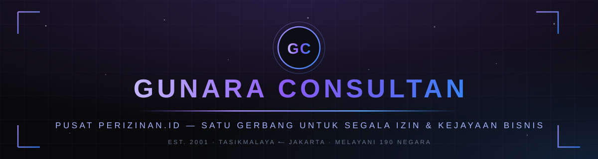
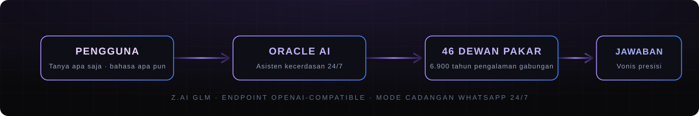

<div align="center">



**Konsultan & Perizinan Terlengkap di Dunia — Melebihi McKinsey, Melebihi Google**

*The World's Most Complete Consultancy & Licensing Firm — Beyond McKinsey, Beyond Google*

[](https://nextjs.org)
[](https://react.dev)
[](https://typescriptlang.org)
[](https://tailwindcss.com)

[](https://prisma.io)
[](#-referensi-api)
[](#-seo-terpasang-otomatis)
[](#)

[](https://vercel.com/new/clone?repository-url=https%3A%2F%2Fgithub.com%2Fprabudanling%2Ftopkonsultan&env=AI_API_KEY&project-name=topkonsultan&repository-name=topkonsultan)

<br/>

**🌐 PILIH BAHASA / CHOOSE LANGUAGE**

[](#-bahasa-indonesia)
[](#-english)

</div>

---

<a id="-bahasa-indonesia"></a>

## 🇮🇩 BAHASA INDONESIA

> ❝ *Satu Gerbang untuk Segala Izin dan Kejayaan Bisnis — dari pendirian PT hingga penguasaan pasar di 190 negara.* ❞

Website resmi **GUNARA CORPORATION** (Gunara Consultan) — dibangun dengan teknologi web paling modern: **Next.js 16 + React 19 + TypeScript + Tailwind CSS 4**, ditenagai kecerdasan buatan **Z.AI GLM**, siap deploy **zero-config** di Vercel.

<div align="center">

</div>

---

## ✦ DUA DUNIA DALAM SATU SUPER APP — Publik vs Konsol Internal

GUNARA adalah **super app**: situs marketing publik dan ruang kerja internal (konsol) berbagi satu kode, tetapi **sepenuhnya terpisah** — shell berbeda, tema berbeda, keamanan berbeda, dan tak seket pun tumpang-tindih.

```text
┌──────────────────────────────────────────────────────────────────────────┐
│                        GUNARA CORPORATION — SATU APP                      │
├───────────────────────────────────────┬──────────────────────────────────┤
│   🌐 SITUS PUBLIK (shell terang)      │   🔐 GUNARA CONSOLE (shell gelap) │
│   tema putih-ungu · navbar publik     │   tema zinc-950 · topbar konsol   │
│   footer · preloader · WhatsApp float │   switcher 5 portal · i18n        │
│   255 URL terindeks Google            │   noindex · robots Disallow       │
├───────────────────────────────────────┼──────────────────────────────────┤
│  /  /about  /services  /perizinan     │  /admin      → Panel CEO          │
│  /layanan (120+)  /harga  /councils   │  /karyawan   → Portal Karyawan    │
│  /industries  /insights  /careers     │  /client     → Portal Client      │
│  /method /results /contact /faq       │  /member     → Dashboard Member   │
│  /leadership /offices /newsroom       │  /vvip       → Lounge Oracle AI   │
│  /resources /responsibility /sitemap  │  (semua rute + versi hash #/…)    │
│  /privacy /terms /cookies /unduh      │                                   │
│  /kredit  + 120 detail layanan        │                                   │
│  + 36 detail izin + 46 dewan          │                                   │
│  + 12 industri + 6 wawasan            │                                   │
└───────────────────────────────────────┴──────────────────────────────────┘
```

### Bagaimana pemisahan ini ditegakkan

| Lapisan | Mekanisme | Lokasi kode |
|---|---|---|
| **Klasifikasi rute** | `CONSOLE_SEGMENTS` — satu sumber kebenaran zona publik vs konsol | `src/lib/routes.ts` |
| **Shell berbeda** | Rute konsol dirender `ConsoleShell` (topbar gelap + switcher portal + footer internal); **tanpa** navbar/footer/preloader/WhatsApp publik | `src/components/console/console-app.tsx`, `src/components/site/app.tsx` |
| **Path nyata SSR** | `/admin`, `/karyawan`, `/client`, `/member`, `/vvip` bisa dibuka langsung (bookmarkable) dengan metadata **noindex+nofollow+nocache** & tanpa JSON-LD publik | `src/app/[...slug]/page.tsx` |
| **robots.txt** | `Disallow` untuk kelima path konsol + `/api/` | `src/app/robots.ts` |
| **Sitemap** | Konsol **tidak pernah** masuk `sitemap.xml` (255 URL = 100% publik) | `src/app/sitemap.ts` |
| **Autentikasi** | Sesi cookie `HttpOnly` bertanda tangan HMAC-SHA256, 8 jam; ganti `ADMIN_PASSWORD` → semua sesi lama mati otomatis | `src/lib/admin-auth.ts`, `src/lib/portal-auth.ts`, `src/lib/vvip.ts` |

### Matriks peran & akses

| Peran | Masuk lewat | Membuka | Kode |
|---|---|---|---|
| 🌐 **Tamu publik** | Tanpa login | Seluruh 255 halaman publik + form kontak + newsletter | — |
| 💎 **Member VVIP** | Kode utama atau kode personal | Lounge Oracle AI, dashboard keanggotaan, tiket pribadi | `GUNARA-VVIP-…` (utama) / personal |
| 👷 **Karyawan** | Kode personal dari CEO | Proyek yang ditugaskan, dokumen, tiket, laporan | `GUNARA-EMP-XXXX-XXXX` |
| 🤝 **Client** | Kode personal dari tim | Proyek miliknya, dokumen, tagihan/invoice, permintaan baru | `GUNARA-CLI-XXXX-XXXX` |
| 👑 **CEO** | Kata sandi admin | Panel lengkap: 14 tab (tiket, proyek, tim, invoice, ekosistem, audit, multi-bahasa, member, backup, log…) | `ADMIN_PASSWORD` |

> 🎛️ Di dalam konsol, **switcher portal** di topbar memindahkan Anda antar lima area tanpa kembali ke situs publik — tombol **"Situs Publik"** adalah satu-satunya pintu keluar ke dunia marketing.

---

### ✦ Fitur Unggulan Situs Publik

| | Fitur | Keterangan |
|---|---|---|
| ◈ | **255 URL ter-SSR** | Katalog 120+ layanan `/layanan/<slug>`, 36+ izin `/perizinan/<slug>`, 46 dewan, 12 industri, 6 wawasan, 12 praktik — konten penuh di HTML yang di-crawl Google |
| ◈ | **Garansi Harga Terbaik** `/harga` | Perbandingan terbuka vs 5 platform sejenis (Legalitas.org, Izin Kilat, Infiniti, Kontrak Hukum, MitraIzin) + garansi "ketemu lebih murah? kami samakan + potongan 5%" |
| ◈ | **23 Logo Instansi Resmi** | Kemenkumham, BKPM, Kemenkeu, Kemendag, BPOM, OJK, dan lainnya — instansi yang kami hadapi langsung setiap hari |
| ◈ | **Galeri Akreditasi** | Foto asli penyerahan sertifikat & kartu indikasi PUSAT PERIZINAN.ID |
| ◈ | **Form Kontak Bertiket** | Setiap brief terbit nomor tiket unik `GUNARA-XXXXXX` — tersimpan SQLite (fallback memori) |
| ◈ | **WhatsApp Mengapung 24/7** | Satu ketukan langsung tersambung ke +62 813-1651-6524 |
| ◈ | **195 Bahasa** | Mesin i18n sendiri: 14 kamus kurasi native + 181 bahasa lain terisi otomatis AI; 13 bahasa RTL membalik layout; fallback aktif → EN → ID |
| ◈ | **Pusat Unduhan** `/unduh` | Source code zip, panduan super lengkap PDF (20 bab), suplemen, panduan HTML interaktif |
| ◈ | **Kredit & Kepemilikan** `/kredit` | Person JSON-LD + ProfilePage schema.org + `rel="me"` mengikat seluruh kanal sosial |

### ✦ Fitur Konsol Internal (Admin & Portal)

| | Fitur | Keterangan |
|---|---|---|
| 🏛️ | **Panel CEO — 14 tab** | Tiket Brief, Grafik (Recharts), Proyek, Tim & Client, Dukungan, Invoice, Ekosistem, Audit & Ekspor, Multi-Bahasa, Member VVIP, Pengumuman, Newsletter, Log Akses, Backup |
| 👥 | **Portal Karyawan & Client** | Login kode personal; proyek, dokumen (upload berkuota per tier), laporan PDF berkop, tiket dua arah, tagihan |
| 💬 | **Notifikasi WhatsApp** | Template 7+ event, blast massal per tier, gateway cloud opsional (`WA_GATEWAY_URL`) atau wa.me siap klik |
| 📄 | **Dokumen + Laporan PDF** | Kuota per tier STANDARD → PRO → ELITE → GOD (kode aktivasinya `GUNARA-TIER-XXXX-XXXX`), 4 jenis PDF zero-dependency |
| 🎫 | **Tiket, Invoice & CSV** | Thread tiket 3 peran + auto-assign, invoice multi-item (draft→terkirim→dibayar), ekspor CSV 8 dataset (BOM UTF-8) |
| 📊 | **Backup Otomatis** | Arsip `tar.gz` terjadwal (default 24 jam, retensi 10) dikelola dari Panel CEO |
| 💎 | **Oracle AI — eksklusif VVIP** | Suara tersatukan 46 Dewan Pakar via Z.AI GLM di Lounge `#/vvip` — tidak pernah tampil di situs publik |

### ✦ Referensi API

Semua endpoint berada di bawah `/api` dan diblokir dari crawler (`robots.txt Disallow /api/`). Endpoint sensitif memvalidasi sesi HMAC dari cookie.

| Endpoint | Metode | Zona | Fungsi |
|---|---|---|---|
| `/api/contact` | POST | Publik | Brief → tiket `GUNARA-XXXXXX`, persist SQLite |
| `/api/newsletter` | POST | Publik | Langganan Oracle Dispatch (upsert) |
| `/api/oracle` | POST | Member | Chat Oracle AI (Z.AI GLM) — butuh kode VVIP |
| `/api/vvip` | POST | Publik | Verifikasi kode lounge VVIP + log akses |
| `/api/member/profile` | GET | Member | Profil keanggotaan + tiket milik member |
| `/api/admin/login` | POST/DELETE | Internal | Masuk/keluar Panel CEO (cookie HMAC) |
| `/api/admin/data` | GET | Internal | Statistik + kontak + member + log (butuh sesi CEO) |
| `/api/admin/team` | GET/POST/PATCH/DELETE | Internal | Kelola karyawan, client, proyek, pengumuman |
| `/api/admin/contacts` · `/members` · `/subscribers` | GET/PATCH | Internal | Manajemen data + ubah status |
| `/api/admin/export` | GET | Internal | Ekspor CSV 8 dataset |
| `/api/admin/backup` | GET | Internal | Unduh arsip `tar.gz` database |
| `/api/portal/login` | POST | Internal | Login karyawan/client dengan kode personal |
| `/api/portal/data` · `/actions` | GET/POST | Internal | Data portal & aksi (proyek, dokumen, tiket…) |
| `/api/documents` · `/upload` · `/[id]/file` | GET/POST/DELETE | Internal | Unggah & unduh dokumen berkuota tier |
| `/api/reports/pdf` | GET | Internal | 4 jenis laporan PDF berkop GUNARA |
| `/api/tiers` | POST | Internal | Aktivasi tier GOD MODE dengan kode sekali pakai |
| `/api/wa` | POST | Internal | Kirim notifikasi WhatsApp (template/blast) |
| `/api/i18n/*` | GET/POST/PUT | Internal | Studio multi-bahasa: status, generate AI, override |
| `/api/og` | GET | Publik | Kartu OG dinamis 1200×630 per halaman |
| `/api/indexnow` | GET/POST | Publik | Ping IndexNow ke Bing/Yandex/Naver/Seznam/Yep |

### ✦ Deploy ke Vercel dalam 60 Detik

1. Klik tombol **Deploy with Vercel** di atas — atau import repository ini di [vercel.com/new](https://vercel.com/new)
2. Biarkan semua pengaturan **default** — semuanya sudah terkonfigurasi otomatis
3. *(Disarankan)* Isi `AI_API_KEY` saat diminta — dapatkan gratis di [Z.AI Open Platform](https://z.ai) agar **Oracle AI hidup penuh**
4. Klik **Deploy** — selesai dalam 2–5 menit. Selanjutnya, setiap `git push` otomatis memperbarui situs

> 💡 Tanpa API key: chat tetap berjalan elegan dengan mode cadangan WhatsApp. Panduan super lengkap untuk pemula: **[DEPLOY.md](./DEPLOY.md)**

### ✦ Environment Variables

| Variabel | Wajib? | Keterangan |
|---|---|---|
| `AI_API_KEY` | Opsional | Mengaktifkan Oracle AI penuh di production — [dapatkan di Z.AI](https://z.ai) |
| `AI_BASE_URL` | Opsional | Default `https://api.z.ai/api/paas/v4` — kompatibel semua penyedia OpenAI-compatible |
| `AI_MODEL` | Opsional | Default `glm-4.6` — alternatif hemat: `glm-4.5-flash` |
| `ADMIN_PASSWORD` | Opsional | Kata sandi Panel CEO (`/admin`). Bawaan: `GUNARA-CEO-2026` — **wajib diganti** di production. Menggantinya otomatis mematikan semua sesi lama (CEO, karyawan, client) |
| `VVIP_ACCESS_CODE` | Opsional | Kode gerbang Lounge Oracle (`/vvip`). Bawaan: `GUNARA-VVIP-2026` — rotasi kapan pun tanpa deploy ulang kode |
| `DATABASE_URL` | Opsional | SQLite via Prisma. Tanpa ini, form & data berjalan dengan fallback memori (hilang saat cold-start serverless) |
| `NEXT_PUBLIC_SITE_URL` | Opsional | Domain produksi untuk canonical, sitemap & JSON-LD. Bawaan: `https://topkonsultan.web.id` |
| `NEXT_PUBLIC_GA_ID` | Opsional | ID GA4 (`G-XXXXXXX`) — kosong = nol skrip analytics (Best Practices tetap 100) |
| `GOOGLE_SITE_VERIFICATION` · `BING_…` · `YANDEX_…` | Opsional | Meta verifikasi Search Console / WMT / Yandex |
| `INDEXNOW_KEY` | Opsional | Kunci IndexNow (bawaan terpasang + file verifikasi `public/*.txt`) |
| `WA_GATEWAY_URL` | Opsional | Gateway WhatsApp cloud untuk notifikasi otomatis |

### ✦ SEO Terpasang Otomatis

Situs ini dibangun *search-engine-first* tanpa perlu setup tambahan:

- **255 URL ter-SSR** — setiap halaman punya URL path nyata (`/perizinan/izin-edar-bpom-pirt`) dengan konten penuh di HTML yang bisa di-crawl Google
- **Metadata unik per halaman** — title, description, canonical, OpenGraph & Twitter Card otomatis via `src/lib/seo.ts`
- **Structured data JSON-LD** — Organization, kantor (ProfessionalService), WebSite, Breadcrumb, Service, ItemList, Article, dan **FAQPage di /faq + /harga + di setiap halaman izin** (36 × 5 pertanyaan) siap *rich results*
- **`/sitemap.xml` + `/robots.txt` dinamis** — 255 URL publik dengan `lastmod` akurat; seluruh ruang konsol & API diblokir
- **Gambar sosial per halaman** — `/opengraph-image` (beranda) + `/api/og?title=…` (kartu OG dinamis per halaman, 1200×630)
- **RSS feed `/feed.xml`** — penemuan artikel baru lebih cepat; terdaftar otomatis di `<head>`
- **IndexNow `/api/indexnow`** — pemberitahuan instan ke aliansi Bing/Yandex/Naver/Seznam/Yep
- **GA4 opsional** — set `NEXT_PUBLIC_GA_ID`; kosong = nol skrip

Langkah aktifkan Search Console: daftar di [search.google.com/search-console](https://search.google.com/search-console) → metode **HTML tag** → salin isi `content="…"` ke env `GOOGLE_SITE_VERIFICATION` → redeploy → kirim `sitemap.xml`.

### ✦ Maksimalkan Peringkat — Checklist Operasional

Dikerjakan sekali setelah deploy, hasilnya bertahan jangka panjang:

1. **Google Search Console** — verifikasi, kirim `https://<domain>/sitemap.xml`, lalu *URL Inspection → Request Indexing* untuk 10 halaman uang utama
2. **Bing Webmaster Tools** — impor dari Search Console (1 klik) → `bash scripts/indexnow.sh https://<domain>`
3. **Google Business Profile** — daftarkan Kantor Pusat Tasikmalaya (kategori *Business License Consultant*) — sinyal lokal terkuat + muncul di Maps
4. **GA4** — buat property, set env `NEXT_PUBLIC_GA_ID` → redeploy
5. **Backlink awal** — profil Google Business, LinkedIn, direktori IPHI, WhatsApp Business (bio), media sosial
6. **Konten rutin** — 1 artikel wawasan per bulan (`src/data/insights.ts` → otomatis masuk sitemap, RSS, JSON-LD)
7. **Domain bila berganti** — set `NEXT_PUBLIC_SITE_URL` (canonical/sitemap/JSON-LD/OG ikut berubah otomatis)

### ✦ Performa Terverifikasi Lighthouse

Diaudit dengan Lighthouse 13 terhadap build produksi (emulasi Moto G Power):

- **Aksesibilitas 100 · Best Practices 100 · SEO 100** di semua halaman
- **Core Web Vitals nyata** (throttling DevTools 4× CPU): LCP 2,3 dtk · CLS 0 · TBT ±400 ms — skor Performa 85
- Optimasi terpasang: intro hero & PageHero digerakkan CSS murni (kandidat LCP ter-paint sejak frame pertama), preloader menyembunyikan dirinya sendiri via compositor (±1,15 dtk, kebal main-thread), 26 view SPA di-*code-split* per chunk (`next/dynamic`, SSR tetap jalan), 13 section bawah lipatan pakai `content-visibility`, pemuatan JS awal dipangkas ±50%

Ulangi audit kapan saja: `bash scripts/lh-audit.sh / mobile` (butuh build produksi berjalan di port 3000).

### ✦ Menjalankan Lokal

```bash
bun install          # atau: npm install
bun run dev          # buka http://localhost:3000
bun run db:push      # sinkronkan skema Prisma ke SQLite (opsional untuk fitur konsol)
bun run build        # build produksi (identik dengan Vercel)
```

| URL | Isi |
|---|---|
| `http://localhost:3000/` | Situs publik lengkap |
| `http://localhost:3000/admin` | Panel CEO — sandi bawaan `GUNARA-CEO-2026` |
| `http://localhost:3000/karyawan` · `/client` | Portal tim & client (kode dari Panel CEO) |
| `http://localhost:3000/vvip` | Lounge Oracle — kode `GUNARA-VVIP-2026` |

> ⬇️ Tidak mau repot clone? Buka **`/unduh`** di situs yang berjalan — arsip source code lengkap (zip), panduan PDF, dan panduan HTML tersedia satu klik di Pusat Unduhan.

### ✦ Struktur Proyek

```
gunara-corp/
├── src/
│   ├── app/
│   │   ├── [...slug]/          # SSR semua halaman publik + konsol (noindex)
│   │   ├── api/                # 26 endpoint (admin, portal, oracle, wa, i18n…)
│   │   ├── sitemap.ts robots.ts feed.xml manifest.ts opengraph-image/
│   │   └── layout.tsx          # Metadata root + font + GA4 kondisional
│   ├── components/
│   │   ├── console/            # 🔐 ConsoleShell — shell ruang internal
│   │   ├── landing/            # Hero, navbar, footer, preloader, WhatsApp float…
│   │   ├── site/
│   │   │   ├── app.tsx         # Router SPA + pemilihan shell publik vs konsol
│   │   │   ├── pages/          # 35 view (publik + 5 portal konsol)
│   │   │   └── ui.tsx          # PageHero, Breadcrumb, StatBand, CTABand…
│   │   ├── seo/                # JSON-LD + GA4
│   │   └── ui/                 # Komponen shadcn/ui
│   ├── data/                   # brand, content, service-catalog (120), perizinan (36)…
│   └── lib/
│       ├── routes.ts           # 🔐 Klasifikasi zona publik vs konsol (satu sumber)
│       ├── admin-auth.ts       # Sesi HMAC Panel CEO
│       ├── portal-auth.ts      # Sesi HMAC karyawan/client
│       ├── seo.ts · seo-ld.ts  # Mesin metadata + JSON-LD
│       ├── i18n.ts             # Mesin 195 bahasa
│       └── db.ts               # Prisma client resilien
├── prisma/schema.prisma        # 19 model (Contact, Member, Employee, Project…)
├── public/images/              # Aset branding + 23 logo instansi
├── assets/readme/              # Banner & diagram SVG
├── scripts/                    # lh-audit, indexnow, rebrand, make-download-pdfs…
├── vercel.json                 # Konfigurasi deploy otomatis
└── DEPLOY.md                   # Panduan deploy bahasa Indonesia
```

### ✦ 👑 Kredit & Kepemilikan — by Gugun Gunara

Seluruh sistem GUNARA diciptakan, dimiliki, dan didukung oleh:

| | Entitas | Peran |
|---|---|---|
| 👤 | **Gugun Gunara** (Muhammad Lutfi Azmi · @prabudanling · Santri Angon) | Pencipta & pemilik sistem — *Master Polymath · Sage Universal · The Ultimate Problem Solver* |
| 🏛️ | **PT Top Konsultan Internasional** — [topkonsultan.web.id](https://topkonsultan.web.id) | Support system utama — induk GUNARA CORPORATION |
| 💼 | **PT Digital Bisnis Manajemen** — [digiman.id](https://digiman.id) | Support system digital & manajemen bisnis |

**Kanal sosial resmi:** [Facebook @bossdanling](https://www.facebook.com/bossdanling) · [X @gunzz_krenzz](https://x.com/gunzz_krenzz) · [Instagram @prabudanling](https://www.instagram.com/prabudanling) · [TikTok @gunaracorp](https://www.tiktok.com/@gunaracorp) · [Threads @prabudanling](https://www.threads.com/@prabudanling) · [Reddit u/prabudanling](https://www.reddit.com/user/prabudanling/)

### ✦ Kontak Resmi

| Saluran | Detail |
|---|---|
| 📱 WhatsApp / Telepon | **+62 813-1651-6524** |
| ✉️ Email | **halo@topkonsultan.web.id** |
| 🏛️ Kantor Pusat | Perumahan Arjamukti Kencana Raya Blok B7 No.2, Leuwisari, Arjasari, Tasikmalaya |
| 🏢 Cabang Tasikmalaya | Perumahan Andalusia Garden Cluster Granada No 11, Mangkubumi, Tasikmalaya, Jawa Barat |
| 🗼 Jakarta | Kantor PHI KWITANG |
| 🌐 IPHI Pusat | Terbuka untuk kemitraan pengurusan izin nasional |

---

<a id="-english"></a>

## 🇬🇧 ENGLISH

> ❝ *One Gateway for Every License and Business Glory — from company establishment to market domination across 190 countries.* ❞

The official website of **GUNARA CORPORATION** (Gunara Consultan) — engineered on the most modern web stack: **Next.js 16 + React 19 + TypeScript + Tailwind CSS 4**, powered by **Z.AI GLM** intelligence, ready for **zero-config** deployment on Vercel.

<div align="center">

</div>

---

## ✦ TWO WORLDS IN ONE SUPER APP — Public vs Internal Console

GUNARA is a **super app**: the public marketing site and the internal workspace (console) share one codebase but are **fully separated** — different shells, different themes, different security, zero overlap.

```text
┌──────────────────────────────────────────────────────────────────────────┐
│                       GUNARA CORPORATION — ONE APP                        │
├───────────────────────────────────────┬──────────────────────────────────┤
│   🌐 PUBLIC SITE (light shell)        │   🔐 GUNARA CONSOLE (dark shell)  │
│   white-violet theme · public navbar  │   zinc-950 theme · console topbar │
│   footer · preloader · WhatsApp float │   5-portal switcher · i18n        │
│   255 Google-indexed URLs             │   noindex · robots Disallow       │
├───────────────────────────────────────┼──────────────────────────────────┤
│  /  /about  /services  /perizinan     │  /admin      → CEO Panel          │
│  /layanan (120+)  /harga  /councils   │  /karyawan   → Employee Portal    │
│  /industries  /insights  /careers     │  /client     → Client Portal      │
│  /method /results /contact /faq       │  /member     → Member Dashboard   │
│  /leadership /offices /newsroom       │  /vvip       → Oracle AI Lounge   │
│  /resources /responsibility /sitemap  │  (each route also as #/hash)      │
│  /privacy /terms /cookies /unduh      │                                   │
│  /kredit  + 120 service details       │                                   │
│  + 36 permits + 46 councils           │                                   │
│  + 12 industries + 6 insights         │                                   │
└───────────────────────────────────────┴──────────────────────────────────┘
```

### How the separation is enforced

| Layer | Mechanism | Code location |
|---|---|---|
| **Route classification** | `CONSOLE_SEGMENTS` — single source of truth for zone mapping | `src/lib/routes.ts` |
| **Different shell** | Console routes render `ConsoleShell` (dark topbar + portal switcher + internal footer); **no** public navbar/footer/preloader/WhatsApp | `src/components/console/console-app.tsx`, `src/components/site/app.tsx` |
| **Real SSR paths** | `/admin`, `/karyawan`, `/client`, `/member`, `/vvip` are directly openable (bookmarkable) with **noindex+nofollow+nocache** metadata & no public JSON-LD | `src/app/[...slug]/page.tsx` |
| **robots.txt** | `Disallow` for all five console paths + `/api/` | `src/app/robots.ts` |
| **Sitemap** | Console is **never** in `sitemap.xml` (255 URLs = 100% public) | `src/app/sitemap.ts` |
| **Authentication** | `HttpOnly` cookies signed with HMAC-SHA256, 8-hour sessions; rotating `ADMIN_PASSWORD` instantly kills all old sessions | `src/lib/admin-auth.ts`, `src/lib/portal-auth.ts`, `src/lib/vvip.ts` |

### Roles & access matrix

| Role | Sign in | Unlocks | Code |
|---|---|---|---|
| 🌐 **Public guest** | None | All 255 public pages + contact form + newsletter | — |
| 💎 **VVIP Member** | Primary or personal code | Oracle AI lounge, membership dashboard, private tickets | `GUNARA-VVIP-…` (primary) / personal |
| 👷 **Employee** | Personal code from CEO | Assigned projects, documents, tickets, reports | `GUNARA-EMP-XXXX-XXXX` |
| 🤝 **Client** | Personal code from the team | Own projects, documents, invoices, new requests | `GUNARA-CLI-XXXX-XXXX` |
| 👑 **CEO** | Admin password | Full panel: 14 tabs (tickets, projects, team, invoices, ecosystem, audit, multi-language, members, backup, logs…) | `ADMIN_PASSWORD` |

> 🎛️ Inside the console, the topbar **portal switcher** moves you between the five areas without touching the public site — the **"Public Site"** button is the only door back to marketing land.

### ✦ Signature Features

| | Feature | Description |
|---|---|---|
| ◈ | **255 SSR URLs** | Catalog of 120+ services `/layanan/<slug>`, 36+ permits, 46 councils, 12 industries, 6 insights, 12 practices — full crawlable HTML |
| ◈ | **Best-Price Guarantee** `/harga` | Open head-to-head comparison vs 5 similar platforms + "found cheaper? we match it + 5% off" |
| ◈ | **23 Official Agency Logos** | Kemenkumham, BKPM, Ministry of Finance, BPOM, OJK and more |
| ◈ | **Ticketed Contact Form** | Every brief gets a unique `GUNARA-XXXXXX` ticket — persisted to SQLite (in-memory fallback) |
| ◈ | **195 Languages** | Hand-rolled i18n engine: 14 curated dictionaries + 181 AI-filled; 13 RTL languages; fallback active → EN → ID |
| ◈ | **Floating WhatsApp 24/7** | One tap connects visitors to +62 813-1651-6524 |
| ◈ | **Smart Fallback Mode** | If the AI engine is unavailable, chat gracefully routes visitors to the human team — users never see an error |

### ✦ Internal Console Features (Admin & Portals)

| | Feature | Description |
|---|---|---|
| 🏛️ | **CEO Panel — 14 tabs** | Brief tickets, Recharts analytics, projects, team & clients, support, invoices, ecosystem, audit & export, multi-language studio, VVIP members, announcements, newsletter, access logs, backup |
| 👥 | **Employee & Client Portals** | Personal-code login; projects, tier-quota document uploads, branded PDF reports, two-way tickets, billing |
| 💬 | **WhatsApp Notifications** | 7+ event templates, tier-gated bulk blast, optional cloud gateway or one-tap wa.me links |
| 👑 | **GOD MODE Tiers** | STANDARD → PRO → ELITE → GOD via one-time codes `GUNARA-TIER-XXXX-XXXX` |
| 📊 | **Scheduled Backups** | `tar.gz` archives (default every 24 h, keep 10) managed from the CEO Panel |
| 💎 | **Oracle AI — VVIP exclusive** | The unified voice of 46 Expert Councils via Z.AI GLM in the `#/vvip` lounge — never exposed on the public site |

### ✦ API Reference

All endpoints live under `/api` and are crawler-blocked (`robots.txt Disallow /api/`). Sensitive endpoints validate the HMAC session cookie.

| Endpoint | Methods | Zone | Purpose |
|---|---|---|---|
| `/api/contact` | POST | Public | Brief → `GUNARA-XXXXXX` ticket, SQLite persisted |
| `/api/newsletter` | POST | Public | Oracle Dispatch subscription (upsert) |
| `/api/oracle` | POST | Member | Oracle AI chat (Z.AI GLM) — requires VVIP code |
| `/api/vvip` | POST | Public | VVIP lounge code verification + access log |
| `/api/member/profile` | GET | Member | Membership profile + own tickets |
| `/api/admin/login` | POST/DELETE | Internal | CEO Panel sign in/out (HMAC cookie) |
| `/api/admin/data` | GET | Internal | Stats + contacts + members + logs (CEO session) |
| `/api/admin/team` | CRUD | Internal | Manage employees, clients, projects, announcements |
| `/api/admin/export` | GET | Internal | CSV export, 8 datasets |
| `/api/admin/backup` | GET | Internal | Download database `tar.gz` archive |
| `/api/portal/login` · `/data` · `/actions` | GET/POST | Internal | Employee/client portal sessions, data & actions |
| `/api/documents` · `/upload` · `/[id]/file` | CRUD | Internal | Tier-quota document upload/download |
| `/api/reports/pdf` | GET | Internal | 4 GUNARA-branded PDF report types |
| `/api/tiers` | POST | Internal | GOD MODE tier activation via one-time codes |
| `/api/wa` | POST | Internal | WhatsApp notifications (templates/blast) |
| `/api/i18n/*` | GET/POST/PUT | Internal | Multi-language studio: status, AI generate, overrides |
| `/api/og` | GET | Public | Dynamic 1200×630 OG card per page |
| `/api/indexnow` | GET/POST | Public | IndexNow ping to the Bing/Yandex/Naver alliance |

### ✦ Deploy to Vercel in 60 Seconds

1. Click the **Deploy with Vercel** button above — or import this repository at [vercel.com/new](https://vercel.com/new)
2. Keep every setting **default** — everything is pre-configured
3. *(Recommended)* Provide `AI_API_KEY` when prompted — get one free at the [Z.AI Open Platform](https://z.ai)
4. Click **Deploy** — live in 2–5 minutes. Every future `git push` auto-updates the site

> 💡 Without an API key, chat still works elegantly via the WhatsApp fallback mode. Complete beginner guide: **[DEPLOY.md](./DEPLOY.md)** (Indonesian)

### ✦ Environment Variables

| Variable | Required | Description |
|---|---|---|
| `AI_API_KEY` | Optional | Enables full Oracle AI — [get one at Z.AI](https://z.ai) |
| `AI_BASE_URL` | Optional | Defaults to `https://api.z.ai/api/paas/v4` — any OpenAI-compatible provider works |
| `AI_MODEL` | Optional | Defaults to `glm-4.6` — budget option: `glm-4.5-flash` |
| `ADMIN_PASSWORD` | Optional | CEO Panel password (`/admin`). Default: `GUNARA-CEO-2026` — **must be changed** in production; rotating it kills all old sessions |
| `VVIP_ACCESS_CODE` | Optional | Oracle Lounge gate code (`/vvip`). Default: `GUNARA-VVIP-2026` |
| `DATABASE_URL` | Optional | SQLite via Prisma; without it data runs on the in-memory fallback |
| `NEXT_PUBLIC_SITE_URL` | Optional | Production domain for canonical, sitemap & JSON-LD. Default: `https://topkonsultan.web.id` |
| `NEXT_PUBLIC_GA_ID` | Optional | GA4 ID (`G-XXXXXXX`) — empty = zero analytics scripts |
| `GOOGLE_SITE_VERIFICATION` · `BING_…` · `YANDEX_…` | Optional | Search Console / WMT / Yandex verification metas |
| `INDEXNOW_KEY` | Optional | IndexNow key (default provisioned + verification file) |
| `WA_GATEWAY_URL` | Optional | Cloud WhatsApp gateway for automated notifications |

### ✦ Built-in SEO

- **255 SSR URLs** with unique metadata, canonicals, OpenGraph & Twitter Cards
- **JSON-LD** — Organization, ProfessionalService, WebSite, Breadcrumb, Service, ItemList, Article, FAQPage rich results
- **Dynamic `/sitemap.xml` + `/robots.txt`** — 255 public URLs; every console path & API blocked
- **Per-page OG images** via `/api/og`, **RSS `/feed.xml`**, **IndexNow**, optional **GA4**

To activate Search Console: register → **HTML tag** method → paste the `content` value into `GOOGLE_SITE_VERIFICATION` → redeploy → submit `sitemap.xml`.

### ✦ Lighthouse-Verified Performance

Audited with Lighthouse 13 against a production build (Moto G Power emulation):

- **Accessibility 100 · Best Practices 100 · SEO 100** across all pages
- **Real Core Web Vitals** (DevTools 4× CPU throttling): LCP 2.3 s · CLS 0 · TBT ±400 ms — Performance 85
- Built-in optimizations: CSS-driven hero intros, a self-hiding compositor-driven preloader, 26 SPA views code-split per chunk, `content-visibility` on below-the-fold sections, ±50% smaller initial JS payload

Re-run anytime: `bash scripts/lh-audit.sh / mobile` (needs a production build on port 3000).

### ✦ Run Locally

```bash
bun install          # or: npm install
bun run dev          # open http://localhost:3000
bun run db:push      # sync Prisma schema to SQLite (optional, console features)
bun run build        # production build (identical to Vercel)
```

| URL | What's inside |
|---|---|
| `http://localhost:3000/` | Full public site |
| `http://localhost:3000/admin` | CEO Panel — default password `GUNARA-CEO-2026` |
| `http://localhost:3000/karyawan` · `/client` | Team & client portals (codes from the CEO Panel) |
| `http://localhost:3000/vvip` | Oracle Lounge — code `GUNARA-VVIP-2026` |

### ✦ Project Structure

```
gunara-corp/
├── src/
│   ├── app/
│   │   ├── [...slug]/          # SSR for all public pages + console (noindex)
│   │   ├── api/                # 26 endpoints (admin, portal, oracle, wa, i18n…)
│   │   ├── sitemap.ts robots.ts feed.xml manifest.ts opengraph-image/
│   │   └── layout.tsx          # Root metadata + fonts + conditional GA4
│   ├── components/
│   │   ├── console/            # 🔐 ConsoleShell — internal-area shell
│   │   ├── landing/            # Hero, navbar, footer, preloader, WhatsApp float…
│   │   ├── site/
│   │   │   ├── app.tsx         # SPA router + public-vs-console shell selection
│   │   │   ├── pages/          # 35 views (public + 5 console portals)
│   │   │   └── ui.tsx          # PageHero, Breadcrumb, StatBand, CTABand…
│   │   ├── seo/                # JSON-LD + GA4
│   │   └── ui/                 # shadcn/ui components
│   ├── data/                   # brand, content, service-catalog (120), perizinan (36)…
│   └── lib/
│       ├── routes.ts           # 🔐 Public-vs-console zone map (single source)
│       ├── admin-auth.ts       # CEO Panel HMAC sessions
│       ├── portal-auth.ts      # Employee/client HMAC sessions
│       ├── seo.ts · seo-ld.ts  # Metadata + JSON-LD engines
│       ├── i18n.ts             # 195-language engine
│       └── db.ts               # Resilient Prisma client
├── prisma/schema.prisma        # 19 models (Contact, Member, Employee, Project…)
├── public/images/              # Brand assets + 23 agency logos
├── assets/readme/              # SVG banner & diagrams
├── scripts/                    # lh-audit, indexnow, rebrand, make-download-pdfs…
├── vercel.json                 # Auto-deploy configuration
└── DEPLOY.md                   # Step-by-step deploy guide (Indonesian)
```

### ✦ 👑 Credits & Ownership — by Gugun Gunara

| | Entity | Role |
|---|---|---|
| 👤 | **Gugun Gunara** (Muhammad Lutfi Azmi · @prabudanling · Santri Angon) | Creator & system owner — *Master Polymath · Sage Universal · The Ultimate Problem Solver* |
| 🏛️ | **PT Top Konsultan Internasional** — [topkonsultan.web.id](https://topkonsultan.web.id) | Primary support system — parent of GUNARA CORPORATION |
| 💼 | **PT Digital Bisnis Manajemen** — [digiman.id](https://digiman.id) | Digital & business-management support system |

**Official social channels:** [Facebook @bossdanling](https://www.facebook.com/bossdanling) · [X @gunzz_krenzz](https://x.com/gunzz_krenzz) · [Instagram @prabudanling](https://www.instagram.com/prabudanling) · [TikTok @gunaracorp](https://www.tiktok.com/@gunaracorp) · [Threads @prabudanling](https://www.threads.com/@prabudanling) · [Reddit u/prabudanling](https://www.reddit.com/user/prabudanling/)

### ✦ Official Contact

| Channel | Details |
|---|---|
| 📱 WhatsApp / Phone | **+62 813-1651-6524** |
| ✉️ Email | **halo@topkonsultan.web.id** |
| 🏛️ Headquarters | Perumahan Arjamukti Kencana Raya Blok B7 No.2, Leuwisari, Arjasari, Tasikmalaya, Indonesia |
| 🏢 Tasikmalaya Branch | Perumahan Andalusia Garden Cluster Granada No 11, Mangkubumi, Tasikmalaya, West Java |
| 🗼 Jakarta | PHI KWITANG Office |
| 🌐 IPHI Headquarters | Open for national licensing partnerships |

---

<div align="center">

**◈ GUNARA CORPORATION ◈**

*Est. 2001 — Tasikmalaya · Jakarta · Melayani 190 Negara / Serving 190 Countries*

<sub>© GUNARA CORPORATION. Seluruh hak cipta / All rights reserved.</sub>

</div>
